# Gerbil｜Pixel11シリーズ特化の汎用DATビューワー
最新のGooglePixelに最適化したMaterial3デザインの汎用DATビューワーです（Pixel11Proで開発）

### インストール
#### Playストア
<a href="https://play.google.com/store/apps/details?id=jp.miyavi.android.gerbil">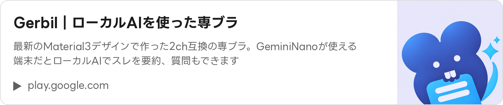</a>

#### Github
[最新リリースをダウンロード](https://github.com/gloria0021/gerbil/releases/latest/download/gerbil-release.apk)

### 動作環境

- Android13以上
- AI機能は端末でGeminiNano（AICore）が使える場合だけ表示されます

### 対応形式

| 形式 | 読む | 書く |
|---|---|---|
| 2ch 互換（bbsmenu・subject.txt・dat・bbs.cgi） | ○ | ○ |
| したらば形式（subject.txt・rawmode.cgi・write.cgi） | ○ | ○ |

## スレ表示・閲覧・書き込み

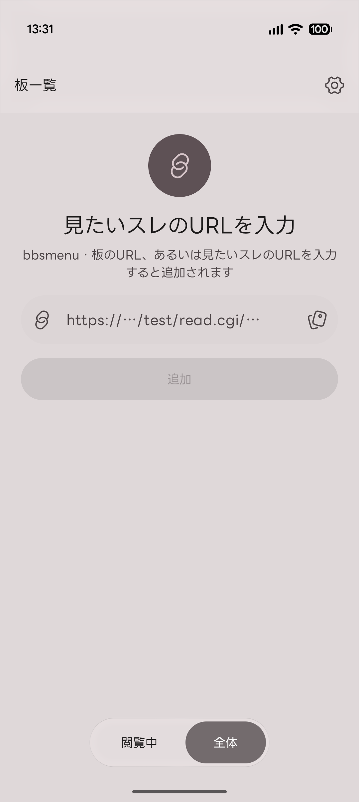 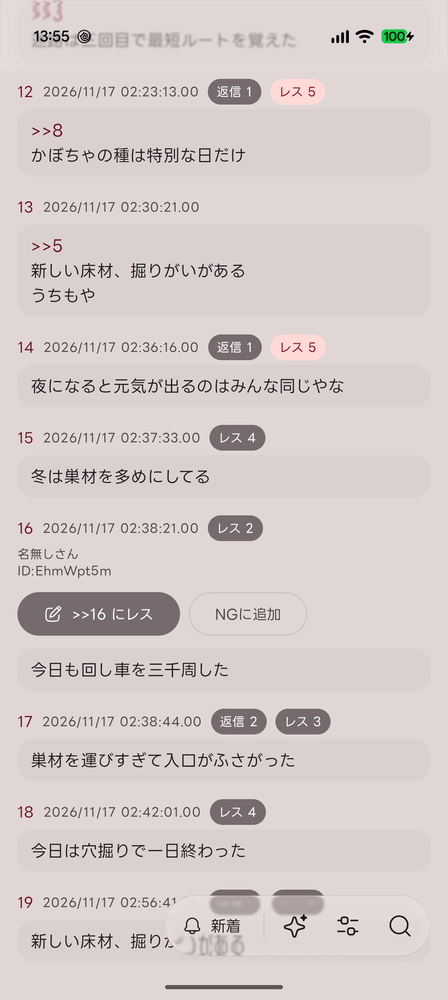

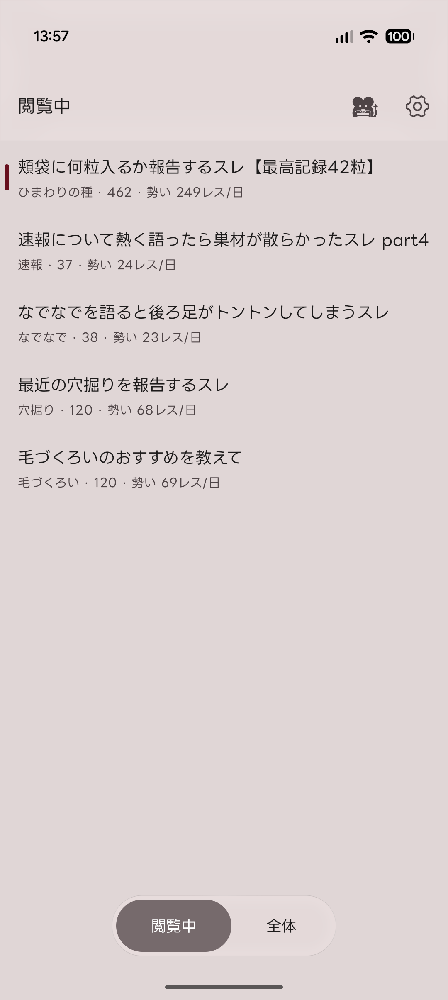 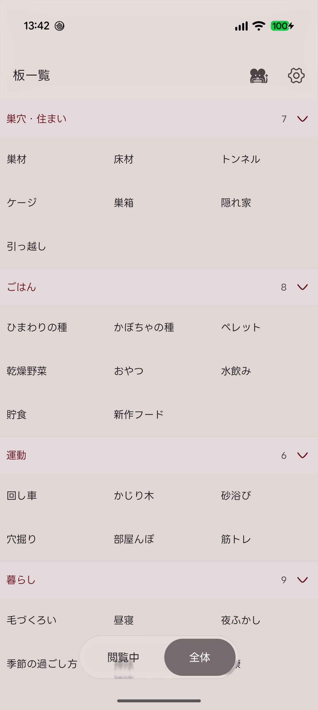

## 設定

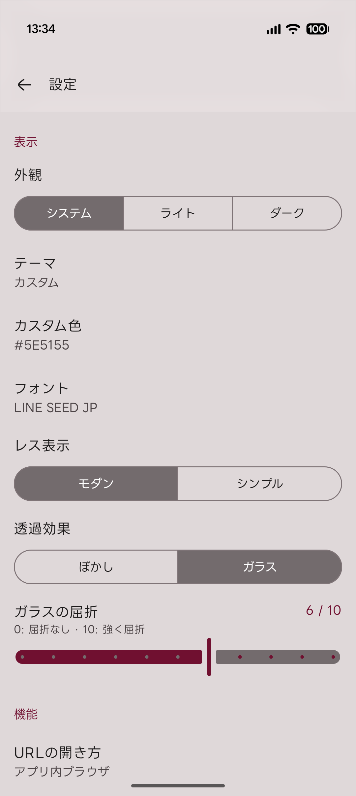 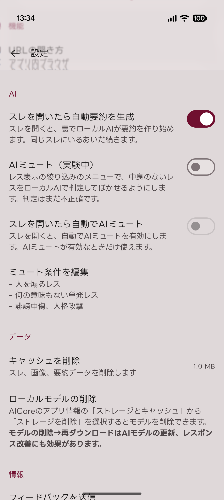

## AI機能

### AIモデルの取得
AIモデルはローカルモデルを使用します。AICoreアプリ経由でインストールできます。

AI機能の利用は対応している端末のみ。

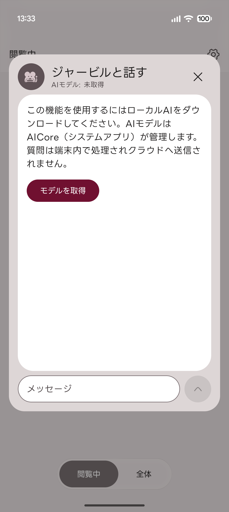 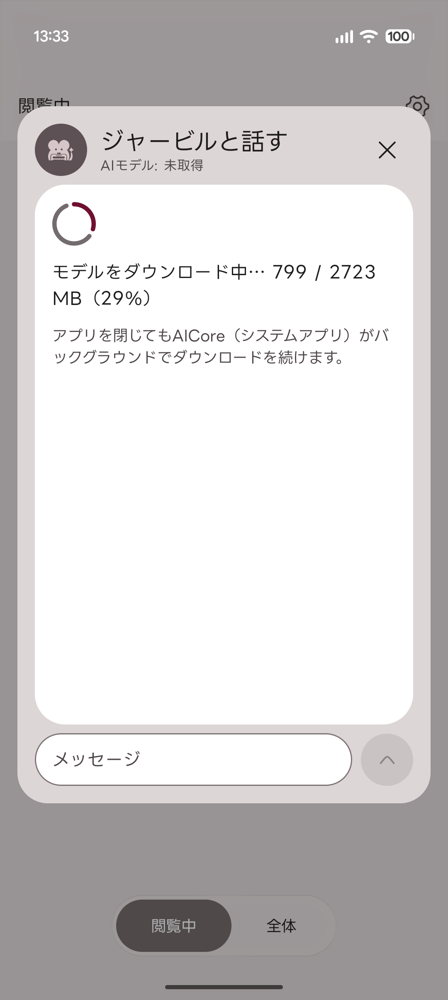

### ジャービルに質問
アプリの使い方に対する質問はこのチャットでしてください。

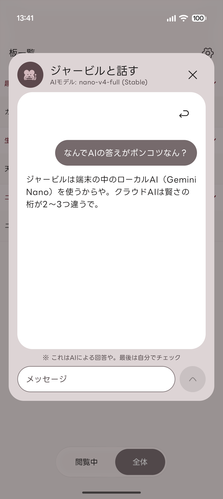 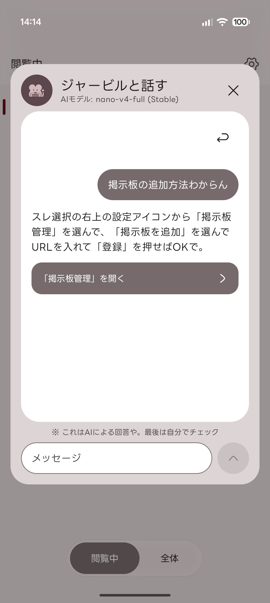

### AI要約・質問
スレを分割で要約します。分割要約にしているのはローカルAIの性能の問題。

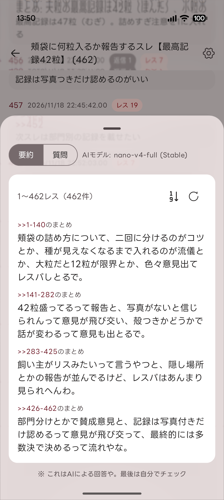 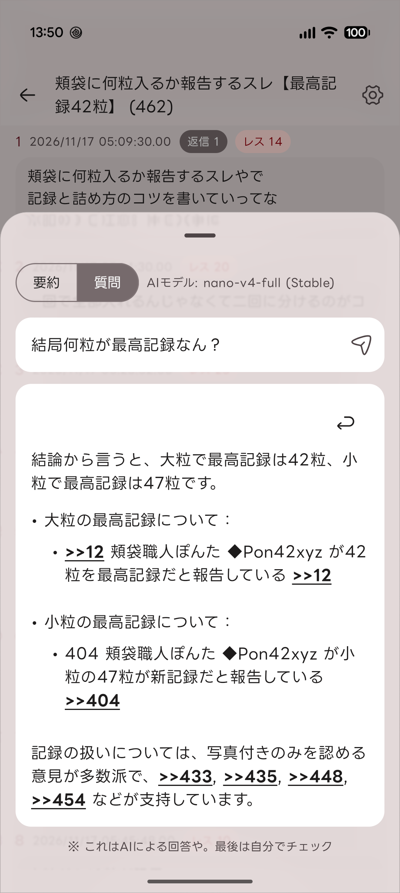

### AIミュート
指定したルールでレスをミュートします。ローカルAIの性能の問題で精度が低いため実験中。

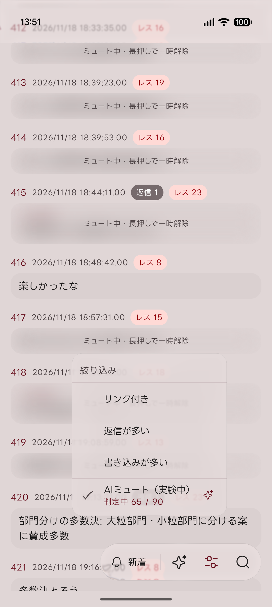

## 今後の予定
### クラウドAI対応
要約やAIミュートはGPT6.1Luna辺りの格安フロンティアモデルを使えば低コストで求めている精度の機能が得られます。QOL上がるのでこの機能は入れたい

## プライバシーポリシー
[プライバシーポリシー](docs/privacy-policy.md)（日本語 / English）

## ライセンス
アプリが使っているライブラリ・アイコン・フォントのライセンスは、アプリの「設定 → オープンソースライセンス」で確認できます。
